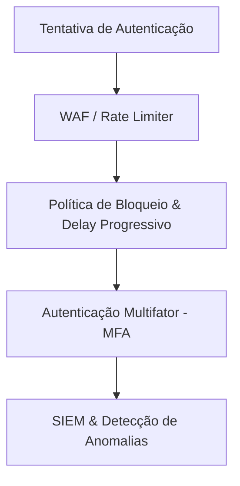

# Relatório Técnico de Análise e Medidas de Mitigação

## 1. Visão Geral das Ameaças Simuladas

Durante os testes de segurança realizados no laboratório, foram simuladas duas categorias centrais de ataques de autenticação:

1. **Ataque de Força Bruta Direto (Brute Force):**
   - **Mecanismo:** Múltiplas combinações de senhas testadas consecutivamente contra uma única conta (ex: `root` ou `admin` no FTP ou no formulário Web).
   - **Impacto:** Comprometimento rápido de contas que utilizam credenciais fracas ou padrão de fábrica.

2. **Ataque de Pulverização de Senhas (Password Spraying):**
   - **Mecanismo:** Teste de uma única senha fraca/comum (ex: `Empresa@2026` ou `Password123`) contra uma ampla lista de usuários corporativos.
   - **Impacto:** Evasão de mecanismos tradicionais de bloqueio de conta (*Account Lockout*), já que cada conta recebe apenas uma tentativa errada por rodada.

---

## 2. Vetores Avaliados e Falhas Identificadas

| Vetor de Ataque | Protocolo / Porta | Causa Raiz da Vulnerabilidade |
| :--- | :--- | :--- |
| **FTP (vsftpd)** | TCP 21 | Ausência de limite de tentativas de login, tráfego em texto claro e existência de contas com credenciais padrão (`msfadmin:msfadmin`). |
| **Web (DVWA)** | TCP 80 | Falta de rate limiting na rota de login, ausência de CAPTCHA e respostas HTTP diferenciadas que facilitam enumeração. |
| **SMB (Samba / Windows)** | TCP 445 | Permissões de enumeração anônima de contas via sessões nulas (Null Sessions) e falta de políticas de complexidade de senha. |

---

## 3. Matriz de Mitigações Recomendadas (Defesa em Profundidade)

### A. Políticas de Senha e Credenciais
- **Abolição de Senhas Padrão:** Obrigar a alteração imediata de credenciais no primeiro logon ou comissionamento de serviços.
- **Complexidade e Comprimento:** Exigir no mínimo 12 a 16 caracteres, combinando maiúsculas, minúsculas, números e caracteres especiais (conforme NIST SP 800-63B).
- **Lista de Bloqueio de Senhas Comuns:** Impedir o cadastro de senhas vazadas em vazamentos públicos conhecidos (como `rockyou.txt`).

### B. Políticas de Bloqueio e Rate Limiting
- **Atraso Exponencial (Exponential Backoff):** Inserir um atraso crescente (ex: 1s, 2s, 4s, 8s) a cada tentativa incorreta de login em vez de bloquear a conta imediatamente (o que impede ataques de negação de serviço em massa).
- **Fail2ban / IP Banning:** Bloquear temporariamente no nível de firewall (iptables/nftables) qualquer endereço IP que exceda 5 tentativas incorretas em uma janela de 5 minutos.

### C. Autenticação Multifator (MFA)
- Implementar obrigatoriamente MFA (TOTP, FIDO2/WebAuthn) em todos os serviços expostos e painéis de acesso remoto.
- O MFA neutraliza 99% dos ataques de força bruta e password spraying, pois a senha correta isolada não permite o logon.

### D. Hardening de Serviços Específicos
- **FTP:** Desativar FTP não criptografado em favor de SFTP (SSH File Transfer Protocol) ou FTPS com TLS obrigatório.
- **SMB:** Restringir o acesso à porta 445 exclusivamente a segmentos de rede autorizados; desabilitar SMBv1 e desativar conexões anônimas (*RestrictAnonymous = 1/2*).
- **Web Applications:** Implementar CAPTCHA adaptativo (Cloudflare Turnstile, reCAPTCHA v3) após 3 tentativas inválidas de autenticação.
